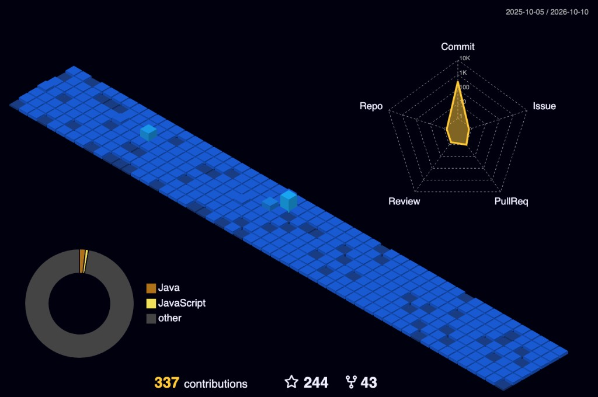
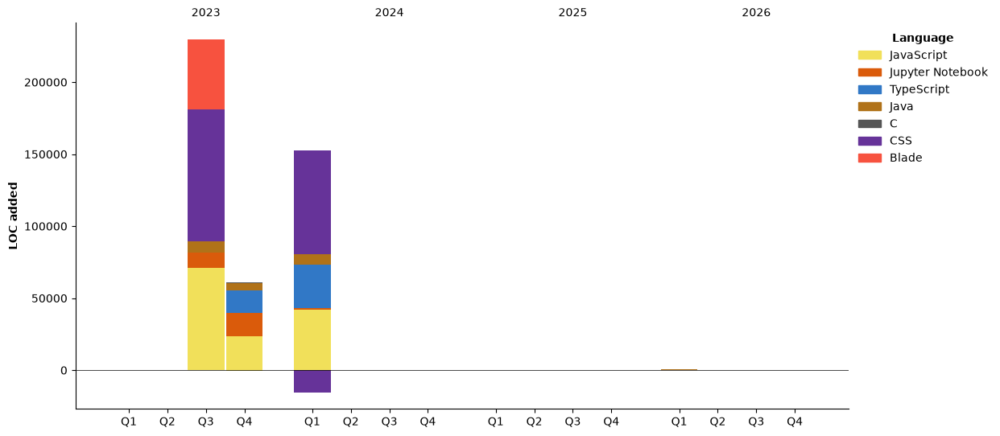

<h1 align="center">Hi there, I'm Samith Thamel 👋</h1>

<h3 align="center">Computer Science Undergraduate | Aspiring DevOps & Cloud Engineer</h3>

  <em>Building practical engineering skills in Cloud Computing, Infrastructure Automation, Containerization, and Linux Systems.</em>

  
  
  
  

  

  

---

## 🧭 Navigation

  
  
  
  
  
  
  

---

## 👨‍💻 About Me

I am a **Computer Science undergraduate** at the **General Sir John Kotelawala Defence University (KDU)**, Sri Lanka, passionate about **Cloud Computing, DevOps, Linux Systems, and Infrastructure Automation**.

I focus on developing practical engineering skills by building real-world projects, configuring virtual machines, experimenting with container technologies, and understanding how modern cloud applications are deployed, automated, and operated reliably.

- 🎓 **Education:** BSc (Hons) in Computer Science — KDU
- ☁️ **Primary Focus:** Cloud Computing & DevOps Engineering
- 🐧 **Operating Systems:** Linux, Ubuntu, and Red Hat Enterprise Linux
- 🐳 **Containers & Orchestration:** Docker and Kubernetes
- ⚙️ **Automation & IaC:** Python, Bash, Terraform, and Ansible
- 🌐 **Networking:** Network Fundamentals, SSH, and System Connectivity
- 🌱 **Mindset:** *Learn by building, troubleshoot by experimenting, and improve continuously.*

  

---

## 🚀 Featured Projects

> Real repositories built and pushed to my GitHub — highlighted by scope, stack, and impact.

<table width="100%">
  <tr>
    <td width="50%" valign="top" bgcolor="#0D1117">

### ✨ [Aura Fashion Suite](https://github.com/SamithThamel/aura-fashion-suite)
> AI-powered fashion retail intelligence platform.

`AI` `Time-Series` `Forecasting` `Inventory` `Virtual Try-On`

- Time-series **demand forecasting** with classification pipelines.
- Inventory **optimization** and automated trend analysis.
- **Photorealistic virtual try-on** studio experience.
- My most recent and largest AI system build.

 

### 🛒 [E-Commerce Website](https://github.com/SamithThamel/E-Commerce-Website)
> Full-stack online storefront.

`PHP` `MySQL` `Web` `E-Commerce`

- Catalog, cart, and checkout flow end-to-end.
- Server-side session and product management.
- Responsive storefront layout and styling.

 

### 🤖 [Fire Detection & Extinguishing Robot](https://github.com/SamithThamel/Advanced-control-system-for-fire-detection-and-extinguishing-robot)
> My first hardware project at university.

`Hardware` `Embedded` `Control-Systems` `First-Year`

- Advanced control system for autonomous fire response.
- Detection-to-extinguishing automation loop.
- Built as a first-year undergraduate engineering project.

 

### 🍔 [Food Blog App](https://github.com/SamithThamel/Food-blog-App)
> Recipe and food blogging web application.

`JavaScript` `Frontend` `Web-App`

- Content-driven recipe browsing and publishing.
- Interactive front-end experience.
- One of my larger front-end builds.

    </td>
    <td width="50%" valign="top" bgcolor="#0D1117">

### 🎟️ [Event Management System V.1.0](https://github.com/SamithThamel/Event-Management-System-V.1.0)
> Comprehensive event operations platform.

`PHP` `MySQL` `Full-Stack` `Largest-Build`

- My **largest repository** by volume and scope.
- Event creation, booking, and attendee management.
- Administrative dashboards and reporting.

 

### 🔍 [AI Quiz Analyzer](https://github.com/SamithThamel/Ai-Quiz-Analyzer)
> Intelligent quiz performance analysis tool.

`Python` `AI` `Analytics` `Automation`

- Parses quiz data and surfaces performance patterns.
- Automated scoring and insight generation.
- Scripting-driven, repeatable analysis workflow.

 

### 🧹 [Clean Stream Sync](https://github.com/SamithThamel/clean-stream-sync)
> Data synchronization and streaming utility.

`TypeScript` `Node` `Data-Pipeline`

- Typed, maintainable synchronization logic.
- Stream-oriented data handling.
- Engineering focus on correctness and clarity.

 

### 🌐 [My Portfolio Website](https://github.com/SamithThamel/New-portfolio)
> Live personal portfolio site.

`HTML` `CSS` `Vercel` `Deployed`

- **Live now** on Vercel — deployed and publicly reachable.
- Responsive personal branding and project showcase.
- Continuous iteration on layout and content.

    </td>
  </tr>
</table>

### 1. 🐳 [Docker Learning](https://github.com/SamithThamel/Docker-Learning)
> **Hands-on foundation for containerization and microservice deployments**

- **Repository:** [`SamithThamel/Docker-Learning`](https://github.com/SamithThamel/Docker-Learning)
- **Tech Stack:** Docker, Dockerfile, Linux, Container Networking
- **Highlights:**
  - In-depth practice with container lifecycle, images, volumes, and port binding.
  - Writing clean, multi-stage `Dockerfile` configurations.
  - Troubleshooting container networking and isolating application dependencies.

### ☁️ 2. Cloud & Infrastructure Automation
> **Automating repeatable cloud infrastructure using Infrastructure as Code (IaC)**

- **Tech Stack:** AWS (EC2, VPC, IAM), Terraform, Linux, SSH
- **Highlights:**
  - Automated cloud resource provisioning using modular Terraform manifests.
  - Configured secure SSH access, security groups, and virtual network topologies.
  - Managing state files and applying repeatable deployment pipelines.

### 🏗️ 3. Kubernetes & Container Orchestration
> **Cluster architecture, deployment management, and workload resilience**

- **Tech Stack:** Kubernetes, `containerd`, Linux VMs, `kubectl`
- **Highlights:**
  - Hands-on cluster configuration spanning control-plane and worker nodes.
  - Deployed workloads using Pods, Deployments, ConfigMaps, and Services.
  - Debugging node registration, pod scheduling, and internal DNS/networking.

<b>📁 All other repositories I've built</b> — click to expand

 

<table width="100%">
  <tr bgcolor="#111827">
    <th>Repository</th>
    <th>Language</th>
    <th>Description</th>
  </tr>
  <tr>
    <td><a href="https://github.com/SamithThamel/Sony_Commercial_Web">Sony_Commercial_Web</a></td>
    <td><code>CSS</code></td>
    <td>Commercial-style product landing page.</td>
  </tr>
  <tr>
    <td><a href="https://github.com/SamithThamel/Magic_Wish">Magic_Wish</a></td>
    <td><code>CSS</code></td>
    <td>Animated, styled front-end concept build.</td>
  </tr>
  <tr>
    <td><a href="https://github.com/SamithThamel/Event-Management-System">Event-Management-System</a></td>
    <td><code>—</code></td>
    <td>My first web project as a 1st year 1st semester undergraduate.</td>
  </tr>
  <tr>
    <td><a href="https://github.com/SamithThamel/Bill-System">Bill-System</a></td>
    <td><code>Python</code></td>
    <td>My first Python project as a 1st year 1st semester undergraduate.</td>
  </tr>
  <tr>
    <td><a href="https://github.com/SamithThamel/Bill-system-on-c-">Bill-system-on-c-</a></td>
    <td><code>C++</code></td>
    <td>C/C++ re-implementation of the billing system.</td>
  </tr>
  <tr>
    <td><a href="https://github.com/SamithThamel/Waste-Water-Treatement">Waste-Water-Treatement</a></td>
    <td><code>—</code></td>
    <td>Companion repository for the Water Treatment academic project.</td>
  </tr>
  <tr>
    <td><a href="https://github.com/SamithThamel/SamithThamel">SamithThamel</a></td>
    <td><code>—</code></td>
    <td>My GitHub profile README.</td>
  </tr>
  <tr>
    <td><a href="https://github.com/SamithThamel/test-web">test-web</a></td>
    <td><code>CSS</code></td>
    <td>Quick front-end styling experiments.</td>
  </tr>
  <tr>
    <td><a href="https://github.com/SamithThamel/New-repo">New-repo</a></td>
    <td><code>—</code></td>
    <td>Sandbox repository for experiments.</td>
  </tr>
</table>

<b>📚 DevOps learning roadmap repositories</b> — curated references I study from

 

<table width="100%">
  <tr bgcolor="#111827">
    <th>Repository</th>
    <th>Focus Area</th>
  </tr>
  <tr><td><a href="https://github.com/SamithThamel/DevOps-Roadmap">DevOps-Roadmap</a></td><td>DevOps learning path & resources (2026)</td></tr>
  <tr><td><a href="https://github.com/SamithThamel/devops-exercises">devops-exercises</a></td><td>Linux, Jenkins, AWS, SRE, Prometheus, Docker, Python</td></tr>
  <tr><td><a href="https://github.com/SamithThamel/into-the-devops">into-the-devops</a></td><td>Linux, Jenkins, AWS, SRE, Prometheus & more</td></tr>
  <tr><td><a href="https://github.com/SamithThamel/Kubernetes-Zero-to-Hero">Kubernetes-Zero-to-Hero</a></td><td>Kubernetes from zero</td></tr>
  <tr><td><a href="https://github.com/SamithThamel/ansible-zero-to-hero">ansible-zero-to-hero</a></td><td>Ansible automation from zero</td></tr>
  <tr><td><a href="https://github.com/SamithThamel/DevSecOps-Zero-to-Hero">DevSecOps-Zero-to-Hero</a></td><td>DevSecOps in a week</td></tr>
  <tr><td><a href="https://github.com/SamithThamel/Golang-for-DevOps">Golang-for-DevOps</a></td><td>Golang fundamentals for DevOps engineers</td></tr>
  <tr><td><a href="https://github.com/SamithThamel/python-for-devops">python-for-devops</a></td><td>Python from a DevOps engineer's perspective</td></tr>
  <tr><td><a href="https://github.com/SamithThamel/terraform-azure-aks">terraform-azure-aks</a></td><td>Terraform on Azure AKS</td></tr>
  <tr><td><a href="https://github.com/SamithThamel/argocd-tutorial">argocd-tutorial</a></td><td>Argo Projects tutorials & examples</td></tr>
  <tr><td><a href="https://github.com/SamithThamel/Cloud-DevOps-Learning-Resources">Cloud-DevOps-Learning-Resources</a></td><td>Books & notes for GCP and cloud</td></tr>
  <tr><td><a href="https://github.com/SamithThamel/AWS-Session">AWS-Session</a></td><td>Deploying a Node.js application on AWS EC2</td></tr>
  <tr><td><a href="https://github.com/SamithThamel/Learning-resources-that-i-want">Learning-resources-that-i-want</a></td><td>100+ developer tools & AI workflows</td></tr>
  <tr><td><a href="https://github.com/SamithThamel/jarvis-ai-assistant">jarvis-ai-assistant</a></td><td>Voice-activated AI assistant</td></tr>
</table>

---

## 🔬 Academic & Innovation Projects

### 💧 Water Treatment Plant Management System
*Academic Software Engineering Project*

- Designed an end-to-end management system for water treatment operations, compliance monitoring, and reporting.
- **Key Features:**
  - Real-time water-quality parameter monitoring with automated threshold alerts.
  - Operator activity logging with photographic verification and audit trails.
  - Compliance records, maintenance tracking, stock management, and shift rosters.
  - Role-based workflows and operational visibility dashboards.

### 🛡️ SafePath — Safety & Emergency Assistance
*Academic Innovation Project*

- Software-driven emergency assistance platform providing real-time hazard awareness and routing.
- **Key Features:**
  - Intelligent route planning algorithms avoiding hazardous zones.
  - Verified emergency shelter directories and dynamic incident alerts.
  - User authentication, secure data management, and responsive communication channels.

---

## 🛠️ Technologies & Tools

  

### 📌 Breakdown by Domain

| Domain | Technologies & Focus Areas |
| :--- | :--- |
| **☁️ Cloud & Infrastructure** | AWS, Virtual Machines (VMs), VPC, IAM, Networking concepts, Infrastructure provisioning |
| **🐳 Containers & Orchestration** | Docker, Dockerfiles, Container Networking, Kubernetes Architecture, Pods, Deployments, Services |
| **🐧 Systems & OS** | Linux Administration, Ubuntu, RHEL, Shell / Bash Scripting, SSH troubleshooting, Process management |
| **⚙️ Automation & IaC** | Terraform, Ansible, Python scripting for system admin, Infrastructure as Code workflows |
| **💻 Development & Collaboration** | Python, Git, GitHub version control, Branching workflows, Code reviews |
| **📊 Monitoring & Observability** | Prometheus, Grafana dashboards, Operational metrics, Logs & System visibility |

> ℹ️ *Note: These tools represent my active learning journey and project implementations.*

---

## 🏆 Achievements & Recognition

<table width="100%">
  <tr>
    <td width="33%" align="center" bgcolor="#0D1117">

#### 🥈 First Runner-Up
**CodeSprite Competition**

    </td>
    <td width="33%" align="center" bgcolor="#0D1117">

#### 🏆 Most Innovative Project
**Ideamart**

    </td>
    <td width="33%" align="center" bgcolor="#0D1117">

#### 💻 Participant & Exhibitor
**TECHXHiBiT 2.0 (2026)**
*KDU BCS Student Chapter*

    </td>
  </tr>
</table>

---

## 📚 Current Learning Roadmap

| Area | Focus Topics | Progress |
| :--- | :--- | :---: |
| **Linux & Systems** | Shell scripting, systemd, process management, permissions, and network troubleshooting |  |
| **Docker & Containers** | Multi-stage builds, volume mounts, networking, Docker Compose orchestration |  |
| **Terraform & IaC** | Providers, reusable modules, remote state management, variables, and outputs |  |
| **Kubernetes** | Pods, Deployments, Services, Ingress controllers, Helm charts, and cluster debugging |  |
| **AWS Cloud** | EC2, VPC, S3, IAM, CloudWatch, and cost-effective architecture design |  |
| **Ansible** | Inventories, playbooks, handlers, roles, and automated configuration management |  |
| **CI / CD Pipelines** | GitHub Actions, automated build/test workflows, containerized image releases |  |
| **Observability** | Prometheus scraping, Grafana dashboards, centralized log aggregation |  |

---

## 📊 GitHub Statistics

  

  
  

<b>🏆 GitHub trophies & contribution graph</b> — click to expand

 

  

  

  

---

## 🎯 Career Goals & What I'm Looking For

My long-term goal is to grow into an impactful **DevOps and Cloud Engineering Professional** with rigorous hands-on competence across Linux environments, cloud architectures, automated deployment pipelines, and site reliability.

- 🔍 **Actively Seeking:**
  - DevOps Engineering Internships
  - Cloud Engineering Internships / Junior Roles
  - Collaborative Open-Source & Infrastructure Automation Projects
- 💡 **Value I Bring:**
  - Strong foundation in systems engineering and container fundamentals.
  - Curiosity and persistence to troubleshoot complex issues.
  - A commitment to continuous learning, documentation, and clean automation.

---

## 🤝 Let's Connect!

I am always keen to collaborate, exchange ideas, and learn from experienced engineers across the industry. Feel free to reach out!

  
  
  
  

  
   
  🕒 <b>Local Time in Sri Lanka (IST · UTC+5:30)</b>

  

  Made with ❤️ by Samith Thamel · KDU, Sri Lanka

